# 0. Cách dùng tài liệu này

Tài liệu này có hai vai trò:

1. **Lộ trình**: chia bài tập lớn thành 12 phase nhỏ, mỗi phase dựng một khối, test được ngay, rồi mới ghép.
2. **Bản đối chiếu**: hai file `RV32I_SingleCycle.circ` và `RV32I_Pipeline.circ` là bản hoàn chỉnh. Mỗi khối mày tự dựng đều có một sub-circuit **cùng tên, cùng tên chân (pin)** trong file của tao. Khi kẹt thì mở sub-circuit đó ra so. Mày cũng có thể chạy **file test vector của tao lên mạch của mày**: nếu tên chân giống nhau thì test chạy được luôn.

**Quy trình làm việc cho mỗi phase:**

```
Đọc phần "Hiểu" → tự vẽ trên Logisim → chạy test vector → (kẹt) mở bản của tao so sánh → qua phase sau
```

Đừng copy-paste sub-circuit của tao vào. Mục tiêu là mày hiểu từng dây. Bản của tao dùng để *so*, không để *chép*.

## 0.1 Cấu trúc thư mục

| Thư mục / file | Nội dung |
|---|---|
| `circ/RV32I_SingleCycle.circ` | CPU đơn chu kỳ hoàn chỉnh (main = `RV32I_SingleCycle`) |
| `circ/RV32I_Pipeline.circ` | CPU pipeline 5 tầng, có forwarding, stall và flush (main = `RV32I_Pipeline`) |
| `circ/extra/RV32I_Pipeline_NoHazard.circ` | Pipeline **cố ý không xử lý data hazard**, dùng để thấy lỗi xảy ra như thế nào (phase 8) |
| `programs/*.s` | Chương trình test viết bằng assembly (ALU, branch, jump, memory, hazard, sort, đệ quy, TTY, UART + GPIO) |
| `programs/fuzz/*.s` | 25 chương trình ngẫu nhiên nhiều hazard, sinh bằng `tools/fuzz.py` |
| `tests/vectors/*.txt` | Test vector cho **từng module** (chạy bằng Simulate → Test Vector) |
| `tools/rvasm.py` | Assembler: `.s` → `.hex` để nạp ROM; có thể nạp thẳng vào file `.circ` |
| `tools/rvsim.py` | Trình mô phỏng tham chiếu (golden model) RV32I + mô hình đếm chu kỳ pipeline |
| `tools/run_tests.py` | Chạy tự động mọi chương trình trên Logisim (không cần GUI) rồi so với golden model |
| `generator/` | Mã Python sinh ra các file `.circ` (đọc thêm nếu muốn; không bắt buộc) |
| `docs/img/*.png` | Ảnh chụp từng mạch |

## 0.2 Đối chiếu với yêu cầu đề bài

| Yêu cầu trong đề | Đáp ứng ở đâu |
|---|---|
| Data 32 bit, lệnh 32 bit, 32 thanh ghi × 32 bit, PC 32 bit, RV32I | Toàn bộ datapath rộng 32 bit · `RegisterFile` (x0 = 0, x1–x31) · thanh ghi `PC` |
| Arithmetic/Logic: ADD SUB AND OR XOR SLT SLTU SLL SRL SRA | `ALU` + `ALUControl` · test `t01_alu.s`, `ALU.txt` |
| Immediate: ADDI ANDI ORI XORI SLTI SLTIU SLLI SRLI SRAI | `ImmGen` + `ALU` · `t01_alu.s` |
| Memory: LW, SW · [optional] LB LH LBU LHU SB SH | `LoadUnit`, `StoreUnit`, RAM `DMEM` · `t05_mem.s` |
| Branch: BEQ BNE JAL JALR · [optional] BLT BGE BLTU BGEU | `BranchUnit`, next-PC MUX · `t03_branch.s`, `t04_jump.s` |
| Phiên bản đơn chu kỳ | `circ/RV32I_SingleCycle.circ` |
| Phiên bản pipeline 5 tầng, xử lý data hazard và control hazard | `circ/RV32I_Pipeline.circ`: `ForwardUnit`, `IDBypass`, `HazardUnit` (load-use stall, flush khi nhảy) · `t06_hazard.s` + 25 chương trình fuzz, số chu kỳ khớp mô hình |
| Chạy từ lệnh nạp vào instruction memory (không chỉnh tay thanh ghi) | ROM `IMEM`. Thanh ghi chỉ thay đổi do lệnh thực thi |
| Công cụ assembly → mã máy nạp ROM ("càng tốt") | `tools/rvasm.py`, đối chiếu khớp 100% với `llvm-mc` |
| [Nâng cao] GPIO/UART | `IOController`: UART TX (TTY), UART RX (Keyboard), GPIO_OUT (4 LED 7 đoạn + 8 LED), GPIO_IN (8 công tắc DIP) · `t11_io.s` |
| [Nâng cao] Tăng performance pipeline (forwarding) | Forwarding đủ từ EX/MEM và MEM/WB, bypass WB→ID, UseRs1/UseRs2 tránh stall oan |
| Source, testbench, chương trình test | `circ/`, `tests/vectors/` (13 module), `programs/` (12 chương trình + 25 fuzz), `tools/run_tests.py` |
| Bộ test cho từng module và toàn CPU | Mục 5.3–5.4 |
| README: mở project, chạy simulation, nạp chương trình, chạy test | `README.md` |
| Báo cáo 10–20 trang, video demo | Nhóm tự làm (gợi ý dàn ý và kịch bản ở phase 11) |

Các mục nâng cao **chưa làm**: branch prediction động, cache, nhân/chia, interrupt, floating point (xem phase 12).

## 0.3 Yêu cầu phần mềm

- **Logisim-evolution 4.1.0** (các file được sinh và kiểm thử với đúng bản này). Bản 3.9.x có thể mở được nhưng không đảm bảo.
- Java 21 (bản `logisim-evolution-4.1.0-all.jar` cần Java 21).
- Python 3.8+ (chỉ để chạy assembler và test, không cần thư viện ngoài).

---

# 1. Kiến thức nền tảng (đọc trước khi vẽ bất cứ thứ gì)

Phần này trả lời các câu "tại sao" mà người chuyển ngang hay bị hỏng gốc.

## 1.1 Tại sao lại là bit (nhị phân)?

Bên trong chip, mỗi dây chỉ có một điện áp. Phân biệt **2 mức** (thấp ≈ 0V = `0`, cao ≈ Vdd = `1`) rất chắc: nhiễu phải đẩy điện áp vượt qua cả nửa dải thì mới đọc sai. Nếu dùng 10 mức (thập phân), khoảng cách giữa các mức chỉ còn 1/10 và nhiễu nhỏ cũng đủ làm sai. Vì vậy **mọi thứ trong CPU là tập hợp các dây 0/1**.

- **1 bit** = 1 dây.
- **Bus n-bit** = n dây đi cùng nhau, biểu diễn một số n-bit. Trong Logisim, một dây có thuộc tính *Data Bits* (độ rộng). Dây 1 bit vẽ mảnh và có màu xanh lá. Dây nhiều bit vẽ đậm và màu đen.
- RV32I nghĩa là **thanh ghi, ALU, địa chỉ đều 32 bit**. Vì vậy phần lớn bus trong CPU rộng 32 bit.

> **Bẫy Logisim #1.** Nối hai đầu có độ rộng khác nhau (ví dụ 32 bit vào chân 5 bit) thì Logisim tô **dây màu cam** và báo *Incompatible widths*. Muốn lấy một phần bit thì dùng **Splitter**. Muốn nới rộng thì dùng **Bit Extender**.

## 1.2 Tại sao dùng hệ hex (thập lục phân)?

32 bit viết ra là `00000000010100000000010100010011`. Đọc như vậy thì không ai nhìn ra gì. Hex gom **4 bit thành 1 chữ số** (`0000`=0 … `1001`=9, `1010`=A … `1111`=F). Vì 16 = 2⁴ nên chuyển đổi chỉ là cắt nhóm 4 bit, không cần làm phép tính:

```
0000 0000 0101 0000 0000 0101 0001 0011   (nhị phân, 32 bit)
   0    0    5    0    0    5    1    3   →  0x00500513   (hex, 8 chữ số)
```

Thập phân thì không làm được như vậy, vì 10 không phải lũy thừa của 2. Do đó mọi probe, pin và nội dung ROM/RAM trong project đều để radix 16. `0x00500513` chính là lệnh `addi a0, x0, 5` (giải mã ở mục 2.3).

Bảng cần thuộc lòng:

| hex | bin | hex | bin |
|---|---|---|---|
| 0 | 0000 | 8 | 1000 |
| 1 | 0001 | 9 | 1001 |
| 2 | 0010 | A | 1010 |
| 3 | 0011 | B | 1011 |
| 4 | 0100 | C | 1100 |
| 5 | 0101 | D | 1101 |
| 6 | 0110 | E | 1110 |
| 7 | 0111 | F | 1111 |

## 1.3 Số âm: bù 2 (two's complement). Vì sao, và hệ quả

Số n-bit theo kiểu bù 2 có bit cao nhất mang trọng số **−2ⁿ⁻¹**. Với 32 bit: `0xFFFFFFFF` = −1, `0x80000000` = −2³¹, `0x7FFFFFFF` = +2³¹−1.

**Vì sao phần cứng chọn bù 2?** Vì cộng số có dấu và cộng số không dấu dùng **chung một bộ cộng**. Còn phép trừ là `A − B = A + (~B) + 1`. ALU không cần biết số đang là có dấu hay không dấu khi cộng hoặc trừ.

**Nhưng có 3 chỗ phần cứng PHẢI biết là có dấu hay không dấu:**

1. **So sánh**: `0xFFFFFFFF < 0x00000001`? Hiểu là có dấu thì −1 < 1 → **đúng** (lệnh SLT, BLT). Hiểu là không dấu thì 4294967295 < 1 → **sai** (lệnh SLTU, BLTU). Vì thế ALU có hai Comparator, một để chế độ *2's complement*, một để *unsigned*.
2. **Dịch phải**: SRL chèn 0 vào bên trái. SRA chèn **bản sao bit dấu** để giữ dấu: −8 >> 1 = −4.
3. **Mở rộng (extension)**: biến số 8, 12 hoặc 16 bit thành 32 bit. *Sign-extend* chép bit dấu sang trái: `0xFB` (−5) thành `0xFFFFFFFB`. *Zero-extend* thêm 0: `0xFB` thành `0x000000FB`. Immediate của RISC-V luôn sign-extend. Lệnh LB/LH sign-extend, còn LBU/LHU zero-extend.

## 1.4 Mạch tổ hợp và mạch tuần tự. Clock và cạnh lên

- **Mạch tổ hợp (combinational)**: đầu ra chỉ phụ thuộc đầu vào *hiện tại*, không có trí nhớ. Gồm cổng logic, MUX, bộ cộng, ALU, decoder, comparator. Đổi đầu vào thì sau một độ trễ lan truyền đầu ra đổi theo.
- **Mạch tuần tự (sequential)**: có trạng thái (trí nhớ). Trong project này là **Register** (gồm PC, 31 thanh ghi x1–x31, các thanh ghi pipeline), **RAM** và bộ đếm.
- **Clock** là sóng vuông 0→1→0→1… Register của Logisim **chỉ chép D vào Q ở cạnh lên** (lúc clock nhảy 0→1). Giữa hai cạnh lên, Q đứng yên. Vì vậy:

> **Mô hình tư duy quan trọng nhất cả môn:** Trong một chu kỳ, toàn bộ mạch tổ hợp "tính" dựa trên giá trị *hiện tại* của các register. Ở cạnh lên kế tiếp, tất cả register **đồng loạt** chụp kết quả. Một CPU chỉ là: *register → mạch tổ hợp → register*.

- **Enable (WE/EN)** của Register: EN = 0 thì cạnh lên không làm gì, register **giữ** giá trị. Pipeline dùng cách này để *stall*.
- **Không bao giờ đưa clock qua cổng logic** (gated clock). Cổng có độ trễ, nên clock đến các register lệch nhau và dữ liệu bị chụp sai. Muốn "tạm dừng" register thì dùng chân **Enable**. Cả project này chỉ có **một** tín hiệu `CLK` đi thẳng đến mọi register.
- Chân **Clear (R)** của Register trong Logisim là **bất đồng bộ**: bật lên là xóa ngay giữa chu kỳ. Vì thế ta không dùng nó để flush pipeline. Flush được làm **đồng bộ** bằng MUX chọn hằng 0 ở đầu vào D (mục 8).

## 1.5 Các linh kiện Logisim dùng trong project. Dùng làm gì, vì sao

| Linh kiện (thư viện) | Làm gì | Dùng ở đâu, vì sao | Bẫy hay gặp |
|---|---|---|---|
| **Pin** (Wiring) | Cổng vào/ra của một circuit | Mỗi sub-circuit giao tiếp qua Pin. Tên Pin = tên chân khi đặt sub-circuit | Để *Radix = 16* cho pin nhiều bit, nếu không pin 32 bit sẽ hiện 32 ô bit rất to |
| **Probe** | Hiển thị giá trị dây, không lái dây | Theo dõi PC, lệnh, kết quả ALU… lúc demo | Probe không nối được *vào* mạch như một nguồn tín hiệu |
| **Tunnel** | "Dây vô hình": các tunnel cùng tên trong **cùng một circuit** là nối với nhau | Tránh dây chằng chịt. Mạch top-level dùng tunnel có tiền tố tầng (`D_rs1`, `E_alu`…) | Gõ sai tên một chữ là đứt dây mà không báo lỗi. Tunnel không xuyên qua ranh giới sub-circuit |
| **Splitter** | Tách bus thành nhóm bit / gộp nhóm bit thành bus | Tách các trường lệnh (opcode, rd, rs1…), ghép bit immediate, lấy `PC[11:2]` | Đặt *Bit x → nhánh y* cho đúng. Bit 0 là bit thấp nhất |
| **Constant** | Hằng số | `4` cho PC+4, `0` cho x0, mask `0xFFFFFFFE` | Độ rộng phải khớp với dây |
| **Bit Extender** | Nới rộng n → m bit kiểu sign / zero / one | Sign-extend immediate, LB/LBU, kết quả SLT (1 bit → 32 bit) | Chọn đúng kiểu sign hay zero |
| **Multiplexer (MUX)** | Chọn 1 trong 2ᵏ đầu vào theo k bit Select | **Linh kiện quan trọng nhất của datapath**: chọn nguồn toán hạng, chọn kết quả ghi lại, chọn PC kế tiếp, forwarding | Đầu vào bỏ trống → ra X (xanh dương) khi được chọn. Nên nối hằng 0 |
| **Decoder** | k bit → 2ᵏ đường, đúng 1 đường = 1 (one-hot) | Chọn thanh ghi cần ghi (RegFile). Nhận dạng nhóm lệnh từ opcode (Control) | Có chân Enable. Disable thì mọi đầu ra = 0 |
| **Comparator** | So sánh A, B → `>`, `=`, `<` | Chế độ *2's complement* cho SLT/BLT, *unsigned* cho SLTU/BLTU, so sánh số hiệu thanh ghi trong forwarding | Nhớ đặt đúng chế độ |
| **Adder / Subtractor** | Cộng / trừ n bit | ALU (ADD/SUB), PC + 4, bộ đếm | Chân carry-in để trống thì Logisim coi là 0, nhưng nên nối hằng 0 cho rõ |
| **Shifter** | Dịch trái logic, phải logic, phải số học | SLL/SRL/SRA. Load/Store unit dịch byte về đúng vị trí | Chân dịch có 5 bit (0..31), đúng chuẩn RV32I chỉ dùng 5 bit thấp |
| **AND/OR/XOR/NOT Gate** | Phép logic theo từng bit | AND/OR/XOR của ALU (32 bit), logic điều khiển (1 bit) | Có thể đảo một chân (Negate) mà không cần thêm cổng NOT |
| **Register** | Lưu n bit, cập nhật ở cạnh lên khi EN = 1 | PC, x1–x31, thanh ghi pipeline, bộ đếm | Chân R (clear) là bất đồng bộ |
| **ROM** | Bộ nhớ chỉ đọc, đọc tổ hợp | Bộ nhớ lệnh IMEM (1K × 32 bit) | Địa chỉ ROM tính theo **word**, không theo byte (mục 2.1) |
| **RAM** | Bộ nhớ đọc/ghi | Bộ nhớ dữ liệu DMEM (4K × 32 bit = 16 KiB). Đặt *Asynchronous read = Yes*, *Data interface = Separate load and store ports* | Mặc định RAM đọc đồng bộ (theo clock). CPU đơn chu kỳ cần đọc tổ hợp |
| **Clock** | Tạo clock | Một clock duy nhất `CLK` | Simulate → Ticks Enabled (Ctrl+K) để chạy tự động |
| **TTY** (I/O) | Màn hình ký tự | Chiều ra của UART, map vào `0xF0000000` | Ghi ký tự ở cạnh lên khi WE = 1 |
| **Keyboard** (I/O) | Hàng đợi ký tự gõ từ bàn phím | Chiều vào của UART, map vào `0xF0000004` | Click vào khối rồi mới gõ. Ký tự bị lấy khỏi hàng đợi ở cạnh lên khi RE = 1 |
| **Hex Digit Display, LedBar, DipSwitch** (I/O) | 1 chữ số hex 7 đoạn; dãy LED; dãy công tắc | GPIO: hiển thị và đọc trạng thái | DipSwitch có 8 chân 1 bit riêng, phải gộp bằng Splitter |

**Màu dây trong Logisim (rất hữu ích khi debug):** xanh lá sáng = 1; xanh lá đậm = 0; đen = bus nhiều bit; **xanh dương = floating** (không ai lái, thường là quên nối); **đỏ = xung đột** (hai nguồn cùng lái một dây, thường do nối nhầm hai output với nhau hoặc trùng tên tunnel); **cam = lệch độ rộng**.

## 1.6 Mẹo thao tác Logisim cần biết

- **Sub-circuit**: Project → Add Circuit. Muốn dùng nó trong mạch khác thì kéo tên circuit từ cây bên trái thả vào. Hình hộp của sub-circuit chỉnh ở Project → Edit Circuit Appearance. File của tao đã vẽ sẵn appearance đẹp cho từng khối.
- **Xem bên trong một sub-circuit đang chạy**: chuột phải lên khối → *View …*. Giá trị hiện ra đúng là giá trị của *instance đó*. Khối RegisterFile của tao còn hiện **cả 32 thanh ghi ngay trên hình hộp**, ở top-level cũng xem được.
- **Chạy từng nửa chu kỳ**: Ctrl+T. **Chạy liên tục**: Ctrl+K, chỉnh tần số ở Simulate → Tick Frequency. **Reset**: Ctrl+R (xóa register và RAM, ROM giữ nguyên).
- **Poke tool** (bàn tay): click vào Pin để đổi giá trị khi test tay.
- **Test Vector**: Simulate → Test Vector… → Load Vector → chọn file `.txt`. Mỗi dòng là một bộ đầu vào kèm đầu ra mong đợi. Logisim báo Pass/Fail từng dòng. **Đây là công cụ để mày tự kiểm tra từng phase.**
- **Nạp chương trình vào ROM**: chuột phải ROM → *Load Image…* → chọn file `*.text.hex` (sinh bằng `tools/rvasm.py`).

---

# 2. RISC-V RV32I trong 15 phút

## 2.1 Trạng thái kiến trúc (cái mà lập trình viên nhìn thấy)

- **32 thanh ghi x0…x31**, mỗi cái 32 bit. **x0 luôn bằng 0**: ghi vào x0 không có tác dụng. Đây là một mẹo thiết kế rất hay: `mv`, `nop`, `j`… đều là lệnh thật dùng x0, nên ISA không cần thêm opcode. Tên ABI: `ra`=x1 (địa chỉ trả về), `sp`=x2 (stack), `t0–t6` (tạm), `s0–s11` (lưu), `a0–a7` (tham số / kết quả).
- **PC** 32 bit: địa chỉ lệnh đang chạy.
- **Bộ nhớ đánh địa chỉ theo byte, little-endian**. Một word 32 bit chiếm 4 byte. Word `0x11223344` đặt ở địa chỉ 0 thì byte 0 = `44`, byte 1 = `33`, byte 2 = `22`, byte 3 = `11`.
  - Hệ quả 1: lệnh dài 4 byte nên **PC tăng 4**, không phải tăng 1.
  - Hệ quả 2: ROM/RAM của Logisim mỗi ô là một word, nên **chỉ số ô = địa chỉ byte / 4 = bỏ 2 bit thấp**. Vì vậy IMEM lấy `PC[11:2]` và DMEM lấy `Addr[13:2]`. Hai bit `Addr[1:0]` cho biết byte nào trong word, dùng cho LB/LH/SB/SH.

## 2.2 Sáu định dạng lệnh

Mọi lệnh dài 32 bit. **opcode luôn ở [6:0], rd ở [11:7], funct3 ở [14:12], rs1 ở [19:15], rs2 ở [24:20]**, ở cùng vị trí trong mọi định dạng có trường đó. Nhờ vậy phần cứng đọc thanh ghi *trước khi* biết lệnh là gì, giải mã song song với đọc register file.

```
          31        25 24   20 19   15 14  12 11        7 6      0
R-type  [  funct7    |  rs2  |  rs1  |funct3|    rd     | opcode ]   add, sub, sll, slt...
I-type  [      imm[11:0]     |  rs1  |funct3|    rd     | opcode ]   addi, lw, jalr...
S-type  [ imm[11:5]  |  rs2  |  rs1  |funct3| imm[4:0]  | opcode ]   sw, sb, sh
B-type  [12|imm[10:5]|  rs2  |  rs1  |funct3|imm[4:1]|11| opcode ]  beq, bne, blt...
U-type  [            imm[31:12]             |    rd     | opcode ]   lui, auipc
J-type  [20|  imm[10:1]   |11|  imm[19:12]  |    rd     | opcode ]   jal
```

**Vì sao bit của B và J bị "xáo trộn"?** Để (1) **bit dấu luôn là inst[31]**, sign-extend bắt đầu được ngay, và (2) các mảnh immediate nằm ở **cùng vị trí** giữa các định dạng (imm[10:5] luôn ở [30:25], imm[4:1] luôn ở [11:8]…), nên ImmGen gần như chỉ là nối dây và MUX ít đầu vào. Offset của B/J không lưu bit 0, vì lệnh luôn chẵn byte, nên tầm nhảy gấp đôi.

## 2.3 Ví dụ giải mã tay

`0x00500513`:

```
0000000 00101 00000 000 01010 0010011
imm=5    rs1=x0  f3=000  rd=x10   opcode=0010011 (OP-IMM)
→ addi a0, x0, 5      (a0 = 5)
```

Bài tập: giải mã `0x40638e33` (đáp án: `sub t3, t2, t1`, funct7 = `0100000`).

## 2.4 Tập lệnh CPU này hỗ trợ (toàn bộ RV32I base, trừ FENCE/CSR)

| Nhóm | Lệnh | Bắt buộc? |
|---|---|---|
| R-type | ADD SUB AND OR XOR SLT SLTU SLL SRL SRA | ✔ |
| I-type ALU | ADDI ANDI ORI XORI SLTI SLTIU SLLI SRLI SRAI | ✔ |
| Load | LW ✔, LB LH LBU LHU | LW bắt buộc, còn lại optional |
| Store | SW ✔, SB SH | SW bắt buộc |
| Branch | BEQ BNE ✔, BLT BGE BLTU BGEU | |
| Jump | JAL JALR | ✔ |
| Upper | LUI AUIPC | (thêm, cần cho `li`/`la` hằng lớn) |
| System | ECALL / EBREAK → **dừng CPU (halt)** | (quy ước của project) |

---

# 3. Kiến trúc tổng thể và các quyết định thiết kế

## 3.1 Sơ đồ khối

```
            ┌──────────── PCSel / Redirect ───────────────┐
            ▼                                             │
  ┌───┐   ┌──┐  ┌──────┐   ┌────────┐  ┌──────┐  ┌─────┐  │  ┌──────┐   ┌───────┐
  │MUX│──▶│PC│─▶│ IMEM │──▶│Control │  │RegFile│─▶│ALU  │──┴─▶│ DMEM │──▶│WB MUX │──┐
  └───┘   └──┘  │ (ROM)│   │ImmGen  │  │32x32 │  │     │     │(RAM) │   └───────┘  │
    ▲  PC+4     └──────┘   └────────┘  └──────┘  └─────┘     └──────┘              │
    └────────────────────────────────────────▲─────────────────────────────────────┘
                                             └─────────── wbdata (ghi lại rd)
       FETCH            DECODE / READ          EXECUTE        MEMORY       WRITE BACK
```

## 3.2 Các quyết định thiết kế quan trọng (và lý do)

| Quyết định | Lý do / trade-off |
|---|---|
| **Harvard**: IMEM (ROM) và DMEM (RAM) tách riêng | Fetch lệnh và load/store không tranh nhau một cổng bộ nhớ. Pipeline cần điều này, nếu không IF và MEM đụng nhau (structural hazard). Đổi lại: không tự sửa mã được (không cần trong bài này). |
| **Mã ALUCtrl = {bit30, funct3}** | ALUCtrl[2:0] **chính là funct3**, bit 3 = SUB/SRA. ALU dùng funct3 chọn kết quả qua MUX 8:1, và ALUControl gần như chỉ là nối dây. Bản mẫu của thầy dùng bảng mã 4 bit tùy ý nên phải có nhiều MUX và hằng số để dịch mã. Nên tận dụng mã hóa sẵn có của ISA. |
| **ALU tính luôn địa chỉ nhảy** (ASel = PC cho branch/JAL) | Không cần bộ cộng riêng `PC+imm`. BEQ/BNE… so sánh rs1, rs2 bằng **BranchUnit riêng**, còn ALU tính PC + imm. JALR: ALU tính rs1 + imm. Target = ALU & ~1. Ít phần cứng hơn, dễ giải thích. |
| **BranchUnit riêng** thay vì dùng cờ Zero của ALU | ALU bận tính địa chỉ. BranchUnit dùng 2 comparator và funct3 để chọn. funct3[0] đảo kết quả (BNE = !BEQ, BGE = !BLT, BGEU = !BLTU), một mẹo mã hóa nữa của RISC-V. |
| **Control vẽ theo kiểu PLA** (Decoder → cột one-hot → các cổng OR) | Bảng chân lý hiện ra ngay trên hình: cột = nhóm lệnh, chấm nối = "nhóm này bật tín hiệu này". Thêm lệnh mới chỉ cần thêm chấm. Sample của thầy dùng 8 comparator. Cách decoder rẻ hơn và đọc dễ hơn. |
| **Lệnh 0x00000000 = NOP an toàn** | Decoder chỉ bật khi `opcode[1:0] = 11`. Lệnh toàn 0 cho mọi tín hiệu điều khiển = 0. Pipeline flush chỉ cần **nạp 0** vào thanh ghi pipeline. |
| **SB/SH bằng read-modify-write** | RAM của Logisim có byte-enable chỉ khi đọc đồng bộ, không dùng được cho đơn chu kỳ. Nên StoreUnit đọc word cũ, thay byte hoặc half cần ghi, rồi ghi lại cả word. Phần cứng thật thường dùng byte-enable, nên ghi điều này vào báo cáo như một trade-off. |
| **EBREAK/ECALL = HALT** | Có điểm dừng rõ ràng để test tự động và quan sát kết quả. Ở pipeline, `halt` bật khi EBREAK tới **WB**, lúc đó mọi lệnh trước nó đã ghi xong. |
| **Memory-mapped I/O** (UART + GPIO) | Mục nâng cao "GPIO/UART". Thiết bị ngoại vi chỉ là vài địa chỉ đặc biệt: CPU dùng đúng lệnh `lw`/`sw`/`lb`/`sb` để điều khiển, không cần lệnh mới. Một comparator trên Addr[31:28] tách RAM và I/O, Addr[4:2] chọn thanh ghi I/O. |
| **Perf counters (cycles, instret)** | Đo **CPI** thật để đưa vào báo cáo và so sánh single-cycle với pipeline. |

## 3.3 Bản đồ bộ nhớ

| Vùng | Địa chỉ | Ghi chú |
|---|---|---|
| IMEM (ROM) | 0x0000_0000 – 0x0000_0FFF | 1024 lệnh. ROM lấy PC[11:2] |
| DMEM (RAM) | 0x0000_0000 – 0x0000_3FFF | 16 KiB. RAM lấy Addr[13:2]. Bit cao hơn bị bỏ qua (alias) |
| Vùng test harness | 0x0000_0700 – 0x0000_077F | `run_tests.py` dump x0..x31 vào đây trước khi halt. Chương trình của mày đừng dùng vùng này |
| Stack | khởi tạo `sp = 0x3FF0` | Phần mềm tự đặt sp (thanh ghi reset về 0) |
| UART_TXDATA | 0xF000_0000 (ghi) | `sb t0, 0(s1)` in ký tự trong t0 ra TTY |
| UART_RXDATA | 0xF000_0004 (đọc) | lấy một ký tự từ Keyboard (đọc xong là ký tự rời hàng đợi) |
| UART_STATUS | 0xF000_0008 (đọc) | bit 0 = có ký tự chờ đọc, bit 1 = TX sẵn sàng (luôn 1) |
| GPIO_OUT | 0xF000_0010 (đọc/ghi) | bit [15:0] → 4 LED 7 đoạn (hex), bit [23:16] → 8 LED |
| GPIO_IN | 0xF000_0014 (đọc) | 8 công tắc DIP |

---

# 4. Lộ trình 12 phase

Ước lượng thời gian cho người mới với Logisim. Đánh dấu ✅ khi xong.

| Phase | Nội dung | Thời gian | Kiểm tra bằng |
|---|---|---|---|
| 0 | Cài đặt, làm quen Logisim, chạy thử bản của tao | 1–2 h | Thấy TTY in "Hello RISC-V!" |
| 1 | ALU | 3–4 h | `ALU.txt` (250 vector) |
| 2 | Register File | 2–3 h | `RegisterFile.txt` (tuần tự, 400 bước) |
| 3 | Immediate Generator | 2 h | `ImmGen.txt` |
| 4 | Control + ALU Control | 3–4 h | `Control.txt`, `ALUControl.txt` |
| 5 | Branch Unit, Load/Store Unit, Address Decoder, I/O Controller | 4 h | `BranchUnit.txt`, `LoadUnit.txt`, `StoreUnit.txt`, `AddrDecode.txt`, `IOController.txt` |
| 6 | Lắp CPU đơn chu kỳ | 4–6 h | `run_tests.py` → 12/12 PASS |
| 7 | Thanh ghi pipeline | 2 h | so với `IF_ID`, `ID_EX`… |
| 8 | Pipeline "ngây thơ" (chưa xử lý hazard) | 3 h | chạy với NOP chèn tay, rồi quan sát lỗi khi bỏ NOP |
| 9 | Forwarding + WB→ID bypass | 3 h | `ForwardUnit.txt`, `IDBypass.txt` |
| 10 | Hazard detection: load-use stall + branch flush | 3 h | `HazardUnit.txt`, rồi `run_tests.py` 12/12 + fuzz 25/25 |
| 11 | Đo CPI, viết báo cáo, quay demo | 1–2 ngày | |
| 12 | (Tùy chọn) mở rộng nâng cao | | |

---

## Phase 0 — Làm quen

1. Mở `circ/RV32I_SingleCycle.circ` bằng Logisim-evolution 4.1.0.
2. Ctrl+K (Ticks Enabled). Chương trình demo đã nằm sẵn trong ROM `IMEM`. Xem: PC tăng, thanh ghi trên khối Register File đổi, cuối cùng TTY in `Hello RISC-V!`, 4 LED 7 đoạn hiện `00E8` (tổng 12 số Fibonacci), 8 LED sáng hết và `halt` = 1.
3. Ctrl+R để reset. Dùng Ctrl+T để chạy từng nửa chu kỳ, và **giải thích được** vì sao mỗi lần PC đổi thì các dây khác đổi theo.
4. Chuột phải khối `ALU` → View ALU, xem bên trong khi đang chạy.
5. Thử nạp chương trình khác:

```bash
python3 tools/rvasm.py programs/t07_fib.s -o build/fib
# → build/fib.text.hex  (chuột phải ROM IMEM > Load Image...)
# → build/fib.data.hex  (chuột phải RAM DMEM > Load Image... nếu chương trình có .data khởi tạo)
```

**Bắt đầu file của mày:** tạo file mới `MyCPU.circ`. Mỗi phase dưới đây là một circuit mới trong file đó. **Đặt tên circuit và tên Pin giống hệt bảng interface** để dùng được test vector của tao.

---

## Phase 1 — ALU

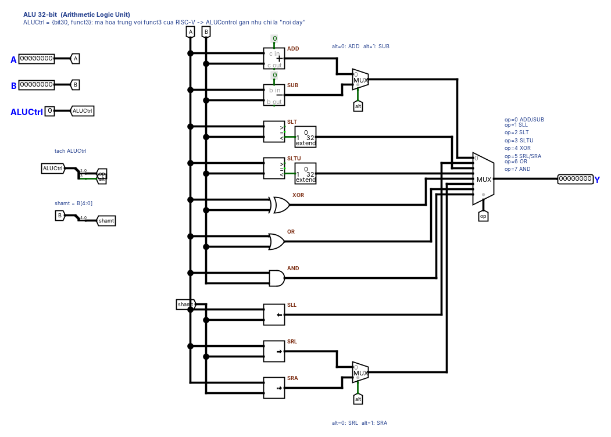

**Hiểu.** ALU là mạch tổ hợp: (A, B, ALUCtrl) → Y. Cách xây "đúng bài" rất đơn giản: **tính song song mọi phép toán, rồi dùng MUX chọn một kết quả**. Phần cứng không "chạy if-else". Mọi khối đều tính cùng lúc, MUX chỉ chọn đầu ra.

**Interface** (circuit `ALU`):

| Pin | Hướng | Bit | Ý nghĩa |
|---|---|---|---|
| A | in | 32 | toán hạng 1 |
| B | in | 32 | toán hạng 2 |
| ALUCtrl | in | 4 | {alt, op}: op = funct3, alt = bit 30 |
| Y | out | 32 | kết quả |

| ALUCtrl | Phép | ALUCtrl | Phép |
|---|---|---|---|
| 0000 | ADD | 1000 | SUB |
| 0001 | SLL | 0101 | SRL |
| 0010 | SLT | 1101 | SRA |
| 0011 | SLTU | 0110 | OR |
| 0100 | XOR | 0111 | AND |

**Các bước:**

1. Đặt 3 Pin vào (A, B 32 bit; ALUCtrl 4 bit, radix 16) và 1 Pin ra Y (32 bit).
2. Splitter tách ALUCtrl thành `op` = bit 0–2 và `alt` = bit 3.
3. Splitter lấy `shamt = B[4:0]` (5 bit). Vì sao? RV32I chỉ dịch 0..31, phần cứng bỏ qua bit cao. `sll` với B = 35 thì dịch 3. Test t01 kiểm tra đúng điều này.
4. Đặt 10 khối song song: Adder, Subtractor, Comparator (2's complement), Comparator (unsigned), XOR/OR/AND (32 bit), 3 Shifter (ll / lr / ar).
5. Comparator cho ra 1 bit `<`. Dùng **Bit Extender zero 1→32** để thành `0x00000001` hoặc `0x00000000` (kết quả SLT là một số 32 bit).
6. MUX 2:1 chọn ADD/SUB theo `alt`. MUX 2:1 chọn SRL/SRA theo `alt`.
7. MUX 8:1 (select 3 bit = `op`). Đầu vào i nối với phép có funct3 = i: 0 add/sub, 1 sll, 2 slt, 3 sltu, 4 xor, 5 srl/sra, 6 or, 7 and.
8. Simulate → Test Vector → `tests/vectors/ALU.txt` → phải Pass 250/250.

**Vì sao dùng Subtractor riêng thay vì "A + ~B + 1"?** Cho dễ đọc. Phần cứng thật dùng chung một bộ cộng với cổng XOR đảo B và carry-in = 1 để tiết kiệm diện tích. Ghi vào báo cáo như một hướng tối ưu.

**Lỗi hay gặp:** để Comparator ở chế độ mặc định rồi sai SLT với số âm. Quên Bit Extender nên nối 1 bit vào MUX 32 bit (dây cam). Nhầm thứ tự đầu vào MUX.

---

## Phase 2 — Register File

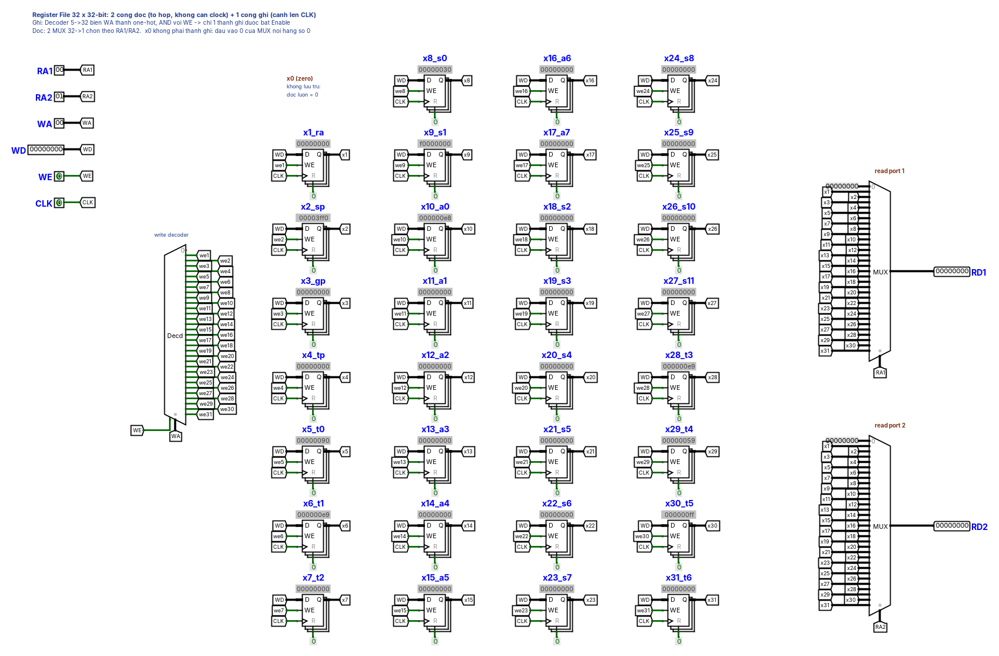

**Hiểu.** 31 Register 32 bit (x1..x31) cùng **2 cổng đọc tổ hợp** và **1 cổng ghi đồng bộ**.

- **Đọc**: MUX 32→1 (select 5 bit = RA1). Đầu vào 0 nối **hằng 0**. Đây là cách hiện thực "x0 luôn = 0": x0 không phải là thanh ghi.
- **Ghi**: Decoder 5→32 biến `WA` thành one-hot. Enable của decoder = `WE`. Đầu ra k nối vào chân EN của thanh ghi xk. Tất cả D nối chung `WD`, tất cả clock nối chung `CLK`. Ở cạnh lên, **chỉ thanh ghi có EN = 1** chụp giá trị.
- Vì sao đọc là tổ hợp mà ghi phải chờ clock? Đọc chỉ là chọn dây (MUX). Ghi thay đổi trạng thái, nên phải đồng bộ để cả CPU đổi trạng thái cùng một thời điểm.

**Interface** (`RegisterFile`): RA1, RA2, WA (5 bit), WD (32), WE (1), CLK (1) → RD1, RD2 (32).

**Mẹo dựng nhanh:** làm một thanh ghi có tunnel `WD`, `CLK`, `we5`, `x5`, rồi copy-paste 31 lần và đổi số. Đặt label cho Register là `x5_t0`… để lúc demo dễ nhìn.

**Kiểm tra:** `RegisterFile.txt`. Đây là test **tuần tự**: cột `CLK` chuyển 0→1 để tạo cạnh lên, cột `<seq>` giữ trạng thái giữa các dòng.

**Lỗi hay gặp:** nối EN của tất cả register vào WE (ghi đè cả 31 thanh ghi). Quên hằng 0 ở đầu vào 0 của MUX đọc. Dùng chân R (clear) để reset.

---

## Phase 3 — Immediate Generator

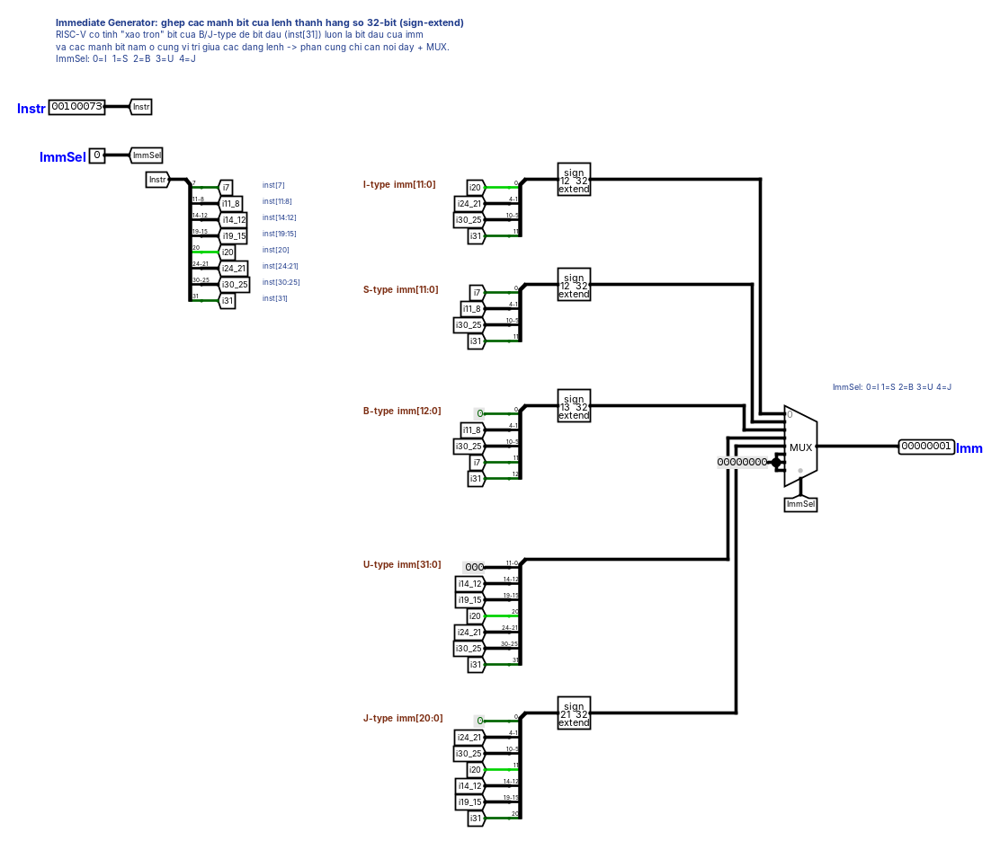

**Hiểu.** Cắt lệnh thành các "mảnh" có vị trí cố định, ghép lại theo từng định dạng, sign-extend lên 32 bit, rồi dùng MUX chọn theo `ImmSel` (0 = I, 1 = S, 2 = B, 3 = U, 4 = J).

| Mảnh | Bit lệnh | I | S | B | U | J |
|---|---|---|---|---|---|---|
| i31 | [31] | imm[11] | imm[11] | imm[12] | imm[31] | imm[20] |
| i30_25 | [30:25] | [10:5] | [10:5] | [10:5] | [30:25] | [10:5] |
| i24_21 | [24:21] | [4:1] | – | – | [24:21] | [4:1] |
| i20 | [20] | [0] | – | – | [20] | [11] |
| i19_15 | [19:15] | – | – | – | [19:15] | [19:15] |
| i14_12 | [14:12] | – | – | – | [14:12] | [14:12] |
| i11_8 | [11:8] | – | [4:1] | [4:1] | – | – |
| i7 | [7] | – | [0] | [11] | – | – |

Bit 0 của B và J luôn là 0. 12 bit thấp của U là 0.

**Các bước:** (1) Splitter 32 bit → 8 mảnh như bảng. (2) Với mỗi định dạng, một Splitter **dùng ngược** (gộp) theo thứ tự bit từ thấp đến cao. (3) Bit Extender *sign* 12→32 (I, S), 13→32 (B), 21→32 (J). U không cần mở rộng. (4) MUX 8:1, các đầu vào 5–7 nối hằng 0.

**Kiểm tra:** `ImmGen.txt`.

---

## Phase 4 — Control Unit và ALU Control

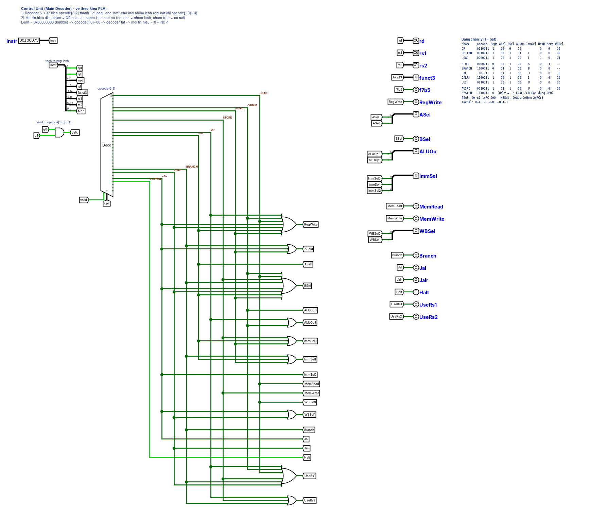

**Hiểu.** Control nhận lệnh 32 bit và sinh **mọi tín hiệu điều khiển** cho datapath. Bắt đầu bằng việc *tự điền bảng chân lý* này **trước** khi vẽ:

| Nhóm | opcode | RegWrite | ASel | BSel | ALUOp | ImmSel | MemRead | MemWrite | WBSel | Branch/Jal/Jalr |
|---|---|---|---|---|---|---|---|---|---|---|
| OP (R) | 0110011 | 1 | 0 rs1 | 0 rs2 | 10 | – | 0 | 0 | 0 ALU | 0/0/0 |
| OP-IMM | 0010011 | 1 | 0 | 1 imm | 11 | 0 I | 0 | 0 | 0 | |
| LOAD | 0000011 | 1 | 0 | 1 | 00 | 0 I | 1 | 0 | 1 Mem | |
| STORE | 0100011 | 0 | 0 | 1 | 00 | 1 S | 0 | 1 | – | |
| BRANCH | 1100011 | 0 | 1 PC | 1 | 00 | 2 B | 0 | 0 | – | 1/0/0 |
| JAL | 1101111 | 1 | 1 PC | 1 | 00 | 4 J | 0 | 0 | 2 PC+4 | 0/1/0 |
| JALR | 1100111 | 1 | 0 rs1 | 1 | 00 | 0 I | 0 | 0 | 2 PC+4 | 0/0/1 |
| LUI | 0110111 | 1 | 2 zero | 1 | 00 | 3 U | 0 | 0 | 0 | |
| AUIPC | 0010111 | 1 | 1 PC | 1 | 00 | 3 U | 0 | 0 | 0 | |
| SYSTEM | 1110011 | 0 | Halt = 1 | | | | | | | |

Thêm `UseRs1` / `UseRs2` (lệnh có thật sự đọc rs1/rs2 không). Pipeline cần hai tín hiệu này để không stall oan (ví dụ LUI không đọc rs1).

**Cách dựng kiểu PLA (như file của tao):**

1. Splitter tách: `opcode[1:0]`, `opcode[6:2]`, rd, funct3, rs1, rs2, bit30 (`f7b5`).
2. `valid = opcode[1] AND opcode[0]`. Decoder 5→32 với select = `opcode[6:2]`, enable = `valid`. Mười đầu ra được dùng chính là 10 nhóm lệnh (LOAD = 0, OP-IMM = 4, AUIPC = 5, STORE = 8, OP = 12, LUI = 13, BRANCH = 24, JALR = 25, JAL = 27, SYSTEM = 28).
3. Mỗi tín hiệu = **OR** các nhóm có số 1 trong cột của nó. Ví dụ `RegWrite = OP | OPIMM | LOAD | JAL | JALR | LUI | AUIPC`.
4. Tín hiệu nhiều bit (ASel, ALUOp, ImmSel, WBSel): làm từng bit rồi gộp bằng Splitter.

**ALU Control:** `op = ALUOp[1] ? funct3 : 000`. `alt = ALUOp[1] AND f7b5 AND (NOT ALUOp[0] OR funct3 == 101)`.

> **Vì sao điều kiện funct3 == 101?** Với ADDI, bit 30 thuộc *immediate* (ví dụ `addi x1, x1, -1024` có bit 30 = 1). Nếu không chặn thì ADDI bị hiểu nhầm thành SUB. Chỉ SRAI (funct3 = 101) mới dùng bit 30 làm "alt". Đây là bug kinh điển. t01 có test bắt lỗi này.

**Kiểm tra:** `Control.txt` (400 lệnh ngẫu nhiên, có cả lệnh không hợp lệ và lệnh 0), `ALUControl.txt` (vét cạn 64 tổ hợp).

---

## Phase 5 — Branch Unit, Load/Store Unit, Address Decoder, I/O Controller

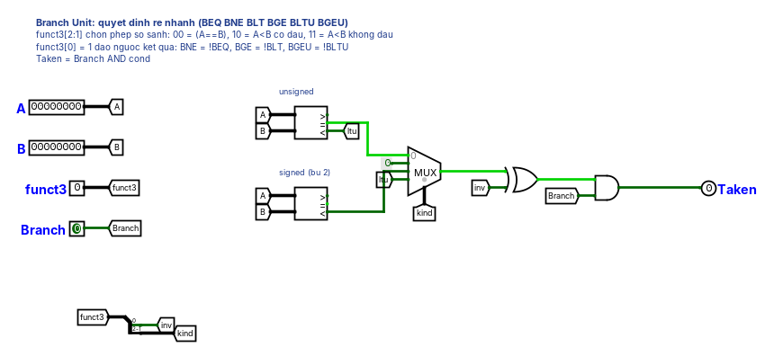

**BranchUnit:** hai Comparator 32 bit (unsigned cho `=` và `<u`, signed cho `<`). MUX 4:1 chọn theo `funct3[2:1]` (00 eq, 10 lt, 11 ltu). XOR với `funct3[0]`, rồi AND với `Branch` ra `Taken`.

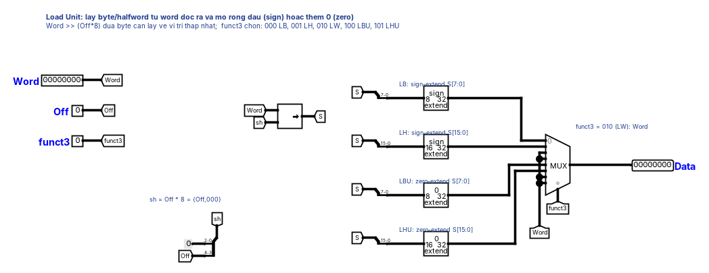
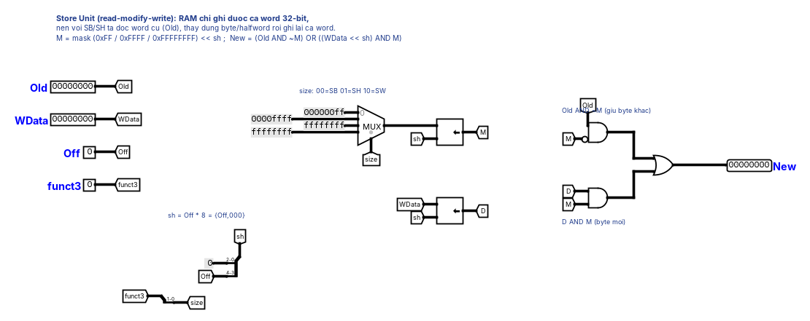

**LoadUnit:** `sh = Off × 8` (gộp {Off, 000}). Dịch phải logic `Word >> sh` để byte cần lấy về vị trí thấp nhất. Bit Extender (sign/zero, 8/16 bit). MUX 8:1 theo funct3 (000 LB, 001 LH, 010 LW, 100 LBU, 101 LHU).

**StoreUnit (read-modify-write):** `M = mask << sh` với mask = 0xFF (SB), 0xFFFF (SH), 0xFFFFFFFF (SW). `New = (Old AND ~M) OR ((WData << sh) AND M)`. Ví dụ: `sb` byte 0xAB vào offset 2 của word cũ 0x11223344 → M = 0x00FF0000 → New = 0x11AB3344.

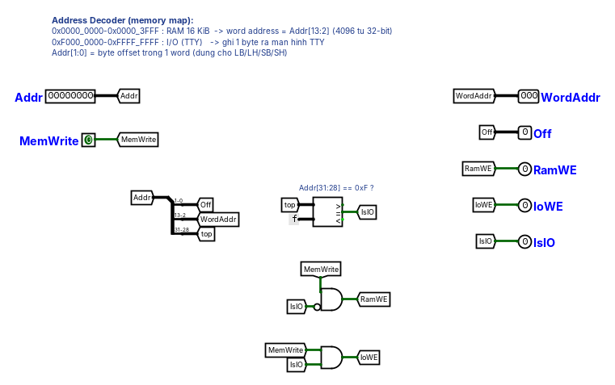

**AddrDecode:** `WordAddr = Addr[13:2]`, `Off = Addr[1:0]`, `IsIO = (Addr[31:28] == 0xF)`. `RamWE = MemWrite AND NOT IsIO`, `IoWE = MemWrite AND IsIO`.

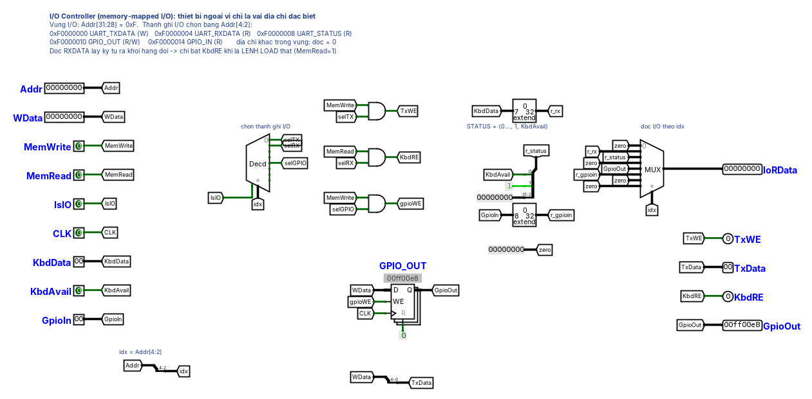

**IOController (GPIO/UART).** Ý tưởng chính của memory-mapped I/O: **thiết bị ngoại vi chỉ là vài địa chỉ đặc biệt**. CPU không cần lệnh mới, cứ `sw` vào `0xF0000010` là đổi đèn, `lw` từ `0xF0000004` là đọc phím.

1. `idx = Addr[4:2]`. Decoder 3→8 (enable = IsIO) chọn thanh ghi I/O.
2. **Ghi**: `TxWE = MemWrite AND sel0` → TTY in ký tự `WData[6:0]`. `GPIO_OUT` là một Register 32 bit, EN = `MemWrite AND sel4`.
3. **Đọc**: MUX 8:1 theo idx: RXDATA (ký tự của Keyboard, zero-extend), STATUS (`{…0, 1, KbdAvail}`), GPIO_OUT, GPIO_IN. Ở top-level, một MUX `IsIO ? IoRData : RAM` đưa dữ liệu này vào LoadUnit, nên `lbu`, `lh`… trên thanh ghi I/O vẫn đúng.
4. **Tác dụng phụ khi đọc**: đọc RXDATA lấy ký tự ra khỏi hàng đợi, nên `KbdRE = MemRead AND sel1`. **Phải có MemRead**: nếu không, một lệnh `add` tình cờ tính ra 0xF0000004 cũng làm mất ký tự. Trong pipeline, việc này chỉ xảy ra ở tầng MEM. Đó là tầng mà lệnh chắc chắn được thực thi (flush chỉ xóa IF/ID và ID/EX). Vì vậy EX/MEM phải mang trường `MemRead`.
5. **Ghi một byte vào GPIO** (`sb` vào 0xF0000012) vẫn đúng, vì StoreUnit lấy word cũ (`Old`) từ chính thanh ghi I/O rồi ghép byte mới vào.

UART ở đây dùng **polling**: phần mềm đọc STATUS lặp lại cho tới khi bit 0 = 1 (xem `programs/t11_io.s`). Không có ngắt.

**Kiểm tra:** 5 file vector tương ứng (`IOController.txt` là test tuần tự có CLK, giống RegisterFile).

---

## Phase 6 — Lắp CPU đơn chu kỳ

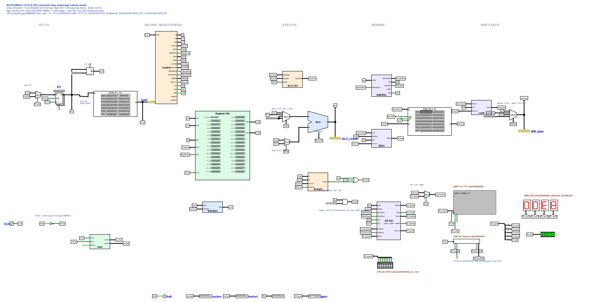

**Đường đi của một lệnh trong MỘT chu kỳ** (tất cả là mạch tổ hợp nối từ PC đến các register):

1. **Fetch:** PC → IMEM (`PC[11:2]`) → `instr`. Song song đó tính `PC + 4`.
2. **Decode:** Control(instr) sinh tín hiệu điều khiển. RegFile đọc rs1, rs2. ImmGen tạo imm.
3. **Execute:** `A = ASel ? (PC | 0) : rs1`, `B = BSel ? imm : rs2`, ALU tính. BranchUnit so rs1 với rs2.
4. **Memory:** địa chỉ = kết quả ALU. StoreUnit ghép dữ liệu ghi. RAM ghi ở cạnh lên nếu RamWE. LoadUnit tách dữ liệu đọc.
5. **Write back:** `wbdata = WBSel: ALU | load | PC+4` → RegFile ghi rd ở cạnh lên.
6. **Next PC:** `PCSel = Taken | Jal | Jalr`. `nextPC = PCSel ? (ALU & ~1) : PC+4`. PC có `EN = NOT Halt`.

**Vì sao cần `& ~1`?** Đặc tả JALR yêu cầu xóa bit 0 của địa chỉ đích. Với branch/JAL thì bit 0 vốn đã bằng 0 nên AND không ảnh hưởng. Dùng chung một mạch cho cả ba.

**Vì sao giới hạn tốc độ của CPU đơn chu kỳ là lệnh LW?** Chu kỳ clock phải đủ dài cho đường dài nhất: ROM → RegFile → ALU → RAM → LoadUnit → MUX → RegFile. Mọi lệnh đều phải chờ thời gian của lệnh chậm nhất, kể cả lệnh ADD. Đây là lý do ra đời pipeline. Logisim không mô phỏng thời gian thật, nên trong báo cáo hãy lập luận bằng *số tầng logic* trên đường găng (critical path).

**Kiểm tra toàn CPU (headless, không cần GUI):**

```bash
python3 tools/run_tests.py MyCPU.circ --jar logisim-evolution-4.1.0-all.jar
```

Runner yêu cầu: circuit main của file là CPU. ROM lệnh có label `IMEM`. Có đúng một RAM. Có Pin ra `halt` (1 bit, Logisim dừng mô phỏng khi pin tên `halt` bằng 1) và các Pin ra `cycles`, `instret`, `pc`, `gpio` (32 bit) đặt **trên cùng một hàng, từ trái sang phải** theo thứ tự đó. Logisim in giá trị pin theo thứ tự trên → dưới, trái → phải.

---

## Phase 7 — Thanh ghi pipeline

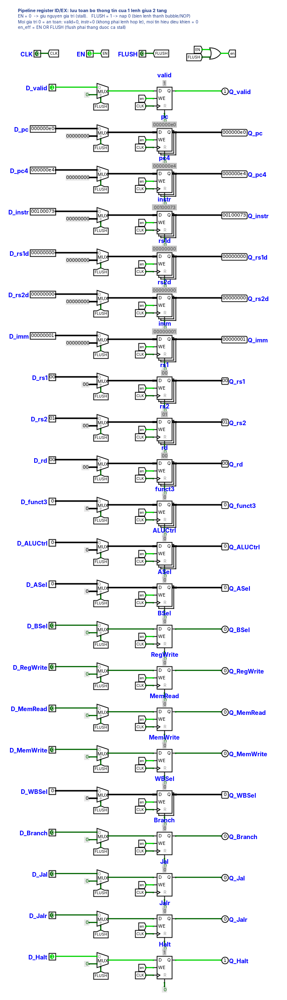

**Hiểu.** Pipeline cắt đường tổ hợp dài thành 5 đoạn. Giữa các đoạn đặt **thanh ghi pipeline** (IF/ID, ID/EX, EX/MEM, MEM/WB). Mỗi thanh ghi pipeline chứa **mọi thứ mà các tầng phía sau cần về lệnh đó**: dữ liệu, số hiệu thanh ghi đích **và cả tín hiệu điều khiển**. Lệnh "mang theo" tín hiệu điều khiển của nó đi qua từng tầng.

Mỗi trường gồm: `MUX(FLUSH ? 0 : D)` → Register (EN = `EN OR FLUSH`) → Q.

- `EN = 0`: giữ nguyên (**stall**).
- `FLUSH = 1`: nạp toàn 0 (**biến lệnh thành bubble**). Vì lệnh 0 = NOP và mọi tín hiệu điều khiển = 0, bubble không ghi gì cả.
- Trường `valid` = 1 với lệnh thật, = 0 với bubble. Dùng cho bộ đếm instret.
- Trường `pc`, `instr` có ở mọi tầng **chỉ để hiển thị** (pipeline monitor), rất hữu ích khi demo "lệnh nào đang ở tầng nào".

Các trường (đúng như file của tao):

| Thanh ghi | Trường |
|---|---|
| IF/ID | valid, pc, pc4, instr |
| ID/EX | valid, pc, pc4, instr, rs1d, rs2d, imm, rs1, rs2, rd, funct3, ALUCtrl, ASel, BSel, RegWrite, MemRead, MemWrite, WBSel, Branch, Jal, Jalr, Halt |
| EX/MEM | valid, pc, instr, exres, sdata, rd, funct3, RegWrite, MemWrite, MemToReg, Halt |
| MEM/WB | valid, pc, instr, exres, mdata, rd, RegWrite, MemToReg, Halt |

`exres` = (JAL/JALR ? PC+4 : ALU), tính ở EX. Nó vừa là địa chỉ bộ nhớ, vừa là giá trị đem forward, vừa là giá trị ghi lại (nếu không phải load). Như vậy từ tầng MEM trở đi chỉ cần MUX 2:1 `MemToReg`.

---

## Phase 8 — Pipeline "ngây thơ" và tận mắt thấy hazard

Ghép 5 tầng với 4 thanh ghi pipeline. **Chưa có** forwarding và stall. Branch/jump được giải quyết ở EX (flush 2 lệnh). File tham khảo: `circ/extra/RV32I_Pipeline_NoHazard.circ`.

Thí nghiệm (dùng Pipeline Monitor ở góc dưới mạch):

```asm
addi x1, x0, 5
addi x2, x1, 1     # cần x1 khi x1 chưa kịp ghi → sai (RAW hazard)
```

```
chu kỳ:        1    2    3    4    5    6
addi x1       IF   ID   EX   MEM  WB         ← x1 chỉ được ghi ở cuối chu kỳ 5
addi x2,x1         IF   ID   EX   MEM  WB    ← đọc x1 ở chu kỳ 3 (ID): giá trị cũ!
```

Với bản NoHazard: chèn **2 lệnh `nop`** giữa hai lệnh thì đúng (WB→ID bypass lo được khoảng cách 3). Bỏ nop thì sai. Chạy `run_tests.py` trên file NoHazard sẽ thấy nhiều test **FAIL**. Điều này cũng chứng minh bộ test thật sự phát hiện được thiếu forwarding.

**Ba loại hazard:**

- **Structural** (tranh tài nguyên): đã tránh nhờ IMEM/DMEM tách riêng và RegFile 2 cổng đọc + 1 cổng ghi.
- **Data (RAW)**: lệnh sau cần kết quả lệnh trước chưa ghi xong. Xử lý ở phase 9–10.
- **Control**: chưa biết lệnh nhảy hay không thì đã nạp tiếp 2 lệnh. Xử lý ở phase 10.

---

## Phase 9 — Forwarding (bypass) và WB→ID bypass

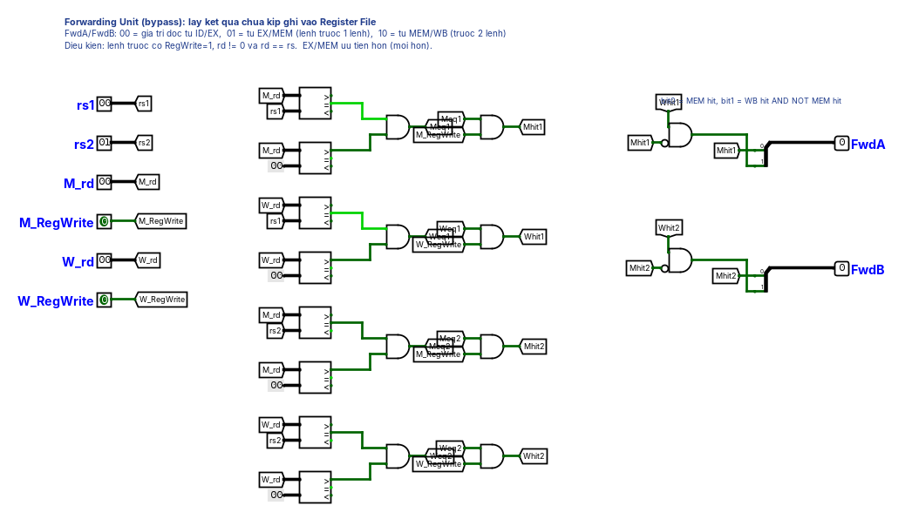

**Ý tưởng.** Kết quả **đã có** ở cuối tầng EX của lệnh trước, chỉ là chưa được ghi vào RegFile. Thay vì chờ, ta **lấy tắt** từ thanh ghi pipeline đưa về đầu vào ALU.

```
FwdA = 01 nếu  EX/MEM.RegWrite và EX/MEM.rd ≠ 0 và EX/MEM.rd = ID/EX.rs1   (lệnh ngay trước)
     = 10 nếu  MEM/WB.RegWrite và MEM/WB.rd ≠ 0 và MEM/WB.rd = ID/EX.rs1   (trước 2 lệnh)
     = 00 nếu  không                                                        (giá trị đọc ở ID)
```

- **Vì sao kiểm tra rd ≠ 0?** `add x0, ...` "ghi" x0. Nếu forward thì lệnh sau đọc x0 sẽ nhận giá trị khác 0, sai đặc tả. t06 có test này.
- **Vì sao EX/MEM ưu tiên hơn MEM/WB?** Nếu cả hai lệnh cùng ghi x5 thì giá trị *mới nhất* thuộc lệnh gần hơn.
- **Forward vào đâu?** Sau MUX forwarding mới đến MUX ASel/BSel. Giá trị đã forward cũng dùng cho BranchUnit và làm dữ liệu store (`sdata`).

**WB→ID bypass (IDBypass).** Lệnh ở WB ghi RegFile ở cạnh lên *cuối* chu kỳ, nhưng lệnh ở ID đọc *trong* chu kỳ đó, nên đọc phải giá trị cũ. Sách giáo khoa giả định "ghi nửa đầu, đọc nửa sau chu kỳ". Trong Logisim ta làm tương đương: nếu `W_rd == rs` thì lấy thẳng `W_data`.

> **Tại sao không cho bypass vào trong RegisterFile luôn?** Vì RegisterFile còn được dùng trong CPU đơn chu kỳ. Ở đó `addi x1, x1, 1` có `rd == rs1`. Bypass sẽ tạo **vòng tổ hợp** (kết quả ALU → WD → bypass → RD1 → ALU) và mạch dao động. Một module không nên ngầm giả định nó được dùng ở đâu.

**Kiểm tra:** `ForwardUnit.txt`, `IDBypass.txt`.

---

## Phase 10 — Hazard Detection: load-use stall và flush khi rẽ nhánh

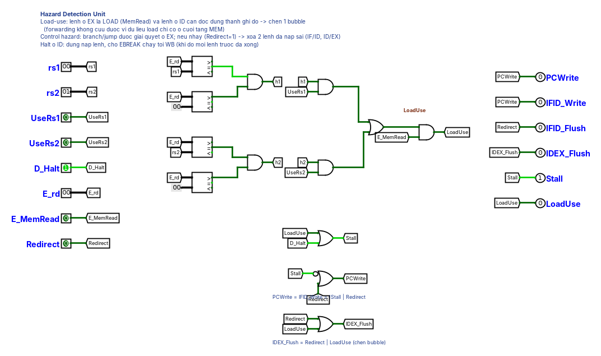

**Load-use: forwarding không cứu được.** Dữ liệu của LW chỉ có ở *cuối* tầng MEM, trong khi lệnh ngay sau cần nó ở *đầu* tầng EX của cùng chu kỳ. Không thể đưa dữ liệu ngược thời gian, nên phải **chờ 1 chu kỳ**:

```
chu kỳ:         1    2    3    4    5    6    7
lw  x5,0(sp)   IF   ID   EX   MEM  WB
add x6,x5,x1        IF   ID   ID*  EX   MEM  WB     (* stall: ở lại ID thêm 1 chu kỳ)
                              ↑ bubble chèn vào EX ở chu kỳ 4; chu kỳ 5 forward từ MEM/WB
```

`LoadUse = ID/EX.MemRead AND ID/EX.rd ≠ 0 AND ((rd == rs1 AND UseRs1) OR (rd == rs2 AND UseRs2))`

Khi LoadUse: `PCWrite = 0`, `IF/ID.EN = 0` (giữ), `ID/EX.FLUSH = 1` (chèn bubble).

**Control hazard: dự đoán "không nhảy" (predict not-taken).** Cứ nạp PC+4. Branch, JAL, JALR được quyết định ở **EX**. Nếu thật sự nhảy (`Redirect = 1`) thì PC ← target, đồng thời **flush IF/ID và ID/EX** (2 lệnh nạp sai), mất 2 chu kỳ.

```
beq (taken)    IF   ID   EX ← Redirect=1
lệnh sai 1          IF   ID → bubble
lệnh sai 2               IF → bubble
lệnh đích                     IF   ID   EX ...
```

**Ưu tiên:** Redirect thắng stall. Khi đó PCWrite = 1 và flush cả hai thanh ghi. `PCWrite = IFID_Write = NOT Stall OR Redirect`. `IDEX_Flush = Redirect OR LoadUse`.

**Halt trong pipeline:** EBREAK ở ID thì ngừng nạp lệnh (`Stall`). `halt` = `MEM/WB.Halt`, chỉ bật khi EBREAK đã tới WB, lúc đó mọi lệnh trước đã ghi xong.

**Công thức chu kỳ (runner kiểm tra đúng số này):**

```
cycles_pipeline = N_lệnh + 4 (lấp đầy pipeline) + 1 × (số load-use) + 2 × (số branch/jump nhảy)
CPI = cycles / N_lệnh
```

**Kiểm tra cuối cùng:**

```bash
python3 tools/run_tests.py MyPipeline.circ --jar logisim-evolution-4.1.0-all.jar
python3 tools/run_tests.py MyPipeline.circ --jar ... --programs programs/fuzz
```

---

## Phase 11 — Đo đạc, báo cáo, demo

Kết quả đo trên bản của tao (chu kỳ = số cạnh clock đến khi halt, không tính đoạn dump của runner):

| Chương trình | Lệnh | Single-cycle CPI | Pipeline cycles | Pipeline CPI | Load-use | Nhảy |
|---|---|---|---|---|---|---|
| demo.s | 188 | 1.00 | 248 | 1.32 | 12 | 22 |
| t07_fib.s | 146 | 1.00 | 188 | 1.29 | 0 | 19 |
| t08_sort.s | 424 | 1.00 | 643 | 1.52 | 45 | 85 |
| t09_recursion.s | 4765 | 1.00 | 7753 | 1.63 | 464 | 1260 |

> **Đừng kết luận "pipeline chậm hơn vì CPI cao hơn".** Thời gian = số chu kỳ × **chu kỳ clock**. Chu kỳ clock của pipeline ≈ 1/5 của đơn chu kỳ (đoạn chậm nhất trong 5 đoạn, cộng overhead của thanh ghi pipeline). Với CPI ≈ 1.3–1.6 và clock nhanh tối đa khoảng 5 lần (thực tế ít hơn, vì 5 tầng không dài bằng nhau và thanh ghi pipeline cũng tốn thời gian), pipeline vẫn có thể nhanh hơn khoảng 2.5–3 lần. Phần **phân tích tại sao CPI > 1** (nguồn: load-use, flush khi nhảy) là phần ăn điểm trong báo cáo. Ví dụ t09 mất 2520 chu kỳ chỉ vì flush nhánh, là động lực cho branch prediction.

**Dàn ý báo cáo 10–20 trang (gợi ý):**

1. Giới thiệu, mục tiêu, công cụ (1 tr).
2. ISA RV32I: định dạng lệnh, tập lệnh hỗ trợ, bản đồ bộ nhớ (2 tr).
3. Thiết kế từng module: interface, sơ đồ (ảnh trong `docs/img`), bảng chân lý, quyết định thiết kế (4–5 tr).
4. CPU đơn chu kỳ: datapath, đường găng, ví dụ chạy 1 lệnh LW (2 tr).
5. Pipeline: thanh ghi pipeline, forwarding, load-use, flush, halt, sơ đồ thời gian (3–4 tr).
6. Kiểm thử: phương pháp golden-model, test vector từng module, test chương trình, fuzz test, kiểm tra số chu kỳ, bảng kết quả (2–3 tr).
7. Đánh giá CPI, hạn chế, hướng mở rộng (1–2 tr).

**Kịch bản demo video (5–7 phút):** (1) mở file, giới thiệu sơ đồ; (2) chạy demo.s trên single-cycle, chỉ vào RegisterFile, TTY, LED 7 đoạn hiện `00E8`; chạy `t11_io.s`, click vào Keyboard, gõ chữ thường và thấy TTY in lại chữ hoa; (3) chạy trên pipeline, dừng ở chỗ có load-use và chỉ Pipeline Monitor (`Stall = 1`, bubble = instr 00000000); dừng ở chỗ branch nhảy và chỉ `E_Redirect = 1`, 2 lệnh bị flush; (4) chạy `run_tests.py` trên terminal và cho thấy ALL PASSED; (5) chạy bản NoHazard để cho thấy FAIL.

---

## Phase 12 (tùy chọn) — Mở rộng nâng cao

| Mở rộng | Gợi ý cách làm | Lợi ích đo được |
|---|---|---|
| Quyết định nhánh ở ID | Đưa comparator lên ID, thêm forwarding vào ID | Phạt nhánh 2 xuống 1 chu kỳ |
| Branch prediction 2-bit + BTB | Bảng nhỏ chỉ số = PC[5:2], lưu target + bộ đếm bão hòa 2 bit | Giảm mạnh flush ở vòng lặp (t08, t09) |
| M extension (MUL/DIV) | Logisim có sẵn Multiplier/Divider. Thêm nhánh ALU với funct7 = 0000001 | t09 không cần phần mềm nhân |
| Cache | Direct-mapped trước DMEM, thêm tín hiệu stall khi miss | |
| Interrupt / CSR | mtvec, mepc, mcause. Cần thêm lệnh CSR | |

---

# 5. Toolchain: assembler, golden model, test runner

## 5.1 Assembler `tools/rvasm.py`

Hỗ trợ toàn bộ RV32I, các pseudo-instruction thông dụng (`li la mv not neg nop j jr ret call beqz bnez bgt ble bgtu bleu seqz snez…`), directive `.text .data .word .half .byte .space .align .ascii .asciz .equ`, `%hi()` và `%lo()`. Đã được đối chiếu mã máy với `llvm-mc` trên 400 lệnh ngẫu nhiên, khớp 100%.

```bash
python3 tools/rvasm.py prog.s -o build/prog                    # → .text.hex .data.hex .lst
python3 tools/rvasm.py prog.s -o build/prog --circ circ/RV32I_Pipeline.circ --circ-out run.circ
                                                               # nạp thẳng vào ROM "IMEM" trong file .circ
```

File `.lst` cho biết địa chỉ, mã máy và dòng nguồn. Mở cạnh Logisim để biết PC = 0x24 là lệnh nào.

**Vì sao `li a1, 0x12345678` thành 2 lệnh?** Immediate của I-type chỉ có 12 bit. `lui` nạp 20 bit cao, `addi` cộng 12 bit thấp. Nhưng `addi` *sign-extend* immediate, nên khi bit 11 của phần thấp = 1 thì phải cộng thêm 1 vào phần cao để bù. Hàm `split_hi_lo` trong assembler làm việc này. Test t02 kiểm tra trường hợp 0x800.

## 5.2 Golden model `tools/rvsim.py`

Trình mô phỏng ở mức lệnh (ISS), viết độc lập với mạch. Nó là **chuẩn để so sánh**: chạy cùng chương trình trên ISS và trên Logisim, rồi so 32 thanh ghi, toàn bộ RAM, chuỗi TTY, giá trị GPIO_OUT và **số chu kỳ** (theo công thức ở phase 10).

```bash
python3 tools/rvsim.py programs/t08_sort.s           # in thanh ghi + số chu kỳ dự đoán
```

## 5.3 Test runner `tools/run_tests.py`

Với mỗi chương trình, runner (1) assemble ở chế độ `--dump`: EBREAK được thay bằng một đoạn mã lưu x1..x31 vào 0x704..0x77C rồi mới halt; (2) nạp ROM vào bản sao của `.circ`; (3) chạy Logisim **không GUI** (`-tty table,halt,tty`, `-l` nạp RAM, `--save` xuất RAM); (4) so với golden model.

```
PASS  t06_hazard.s     1.7s  cycles=110  instret=81  CPI=1.36
...
ALL PASSED
```

## 5.4 Test vector từng module

`tests/vectors/<Module>.txt`. Trong GUI: chọn circuit cần test làm circuit đang xem → Simulate → Test Vector… → Load Vector. Dòng lệnh:

```bash
java -jar logisim-evolution-4.1.0-all.jar -w ALU tests/vectors/ALU.txt MyCPU.circ
```

| File | Số vector | Loại |
|---|---|---|
| ALU.txt | 250 | tổ hợp, gồm biên 0x7FFFFFFF, 0x80000000, −1 |
| ALUControl.txt | 64 | vét cạn |
| BranchUnit.txt | 300 | tổ hợp |
| ImmGen.txt | 300 | lệnh ngẫu nhiên × mọi ImmSel |
| Control.txt | 400 | gồm lệnh không hợp lệ và lệnh 0 |
| RegisterFile.txt | 400 | **tuần tự** (CLK do vector điều khiển) |
| LoadUnit / StoreUnit / AddrDecode | 300 / 300 / 200 | tổ hợp |
| IOController | 400 | **tuần tự** (thanh ghi GPIO_OUT) |
| ForwardUnit / HazardUnit / IDBypass | 400 / 400 / 300 | tổ hợp |

---

# 6. Hạn chế đã biết (ghi trung thực vào báo cáo)

- Truy cập bộ nhớ lệch (misaligned), ví dụ `lw` ở địa chỉ lẻ: không hỗ trợ, kết quả không xác định. Golden model sẽ báo lỗi.
- Không có exception/CSR. ECALL/EBREAK được dùng làm HALT. FENCE thực thi như NOP.
- Thanh ghi và PC reset về 0. Phần mềm phải tự đặt `sp`.
- Vùng I/O chỉ giải mã Addr[31:28] và Addr[4:2]: mọi địa chỉ 0xFxxx_xxxx khác là bí danh (alias) của 8 thanh ghi I/O.
- UART không có ngắt. Phần mềm phải hỏi vòng (polling) thanh ghi STATUS. Bàn phím chỉ có chiều vào ký tự ASCII 7 bit.
- Branch giải quyết ở EX nên mỗi lần nhảy mất 2 chu kỳ (xem phase 12).
- Logisim không mô phỏng trễ thực của cổng, nên "tần số" chỉ để quan sát. Việc so sánh hiệu năng phải dựa trên CPI và lập luận về critical path.

# 7. Khi bị kẹt: checklist debug

1. Dây **xanh dương** → quên nối hoặc tunnel sai tên. Dây **đỏ** → hai nguồn lái cùng một dây.
2. Chạy test vector của module đó trước. Đừng debug cả CPU khi chưa chắc từng khối.
3. Chạy `rvsim.py --trace` để biết lệnh thứ mấy đáng lẽ cho ra giá trị gì. Dùng Ctrl+T trên Logisim đến đúng PC đó rồi so.
4. Pipeline: nhìn Pipeline Monitor. Lệnh ở EX có `rs` trùng `rd` của lệnh ở MEM/WB không? `FwdA/FwdB` có bật đúng không?
5. Mở sub-circuit cùng tên trong file của tao. Đặt hai cửa sổ Logisim cạnh nhau và so từng dây.
